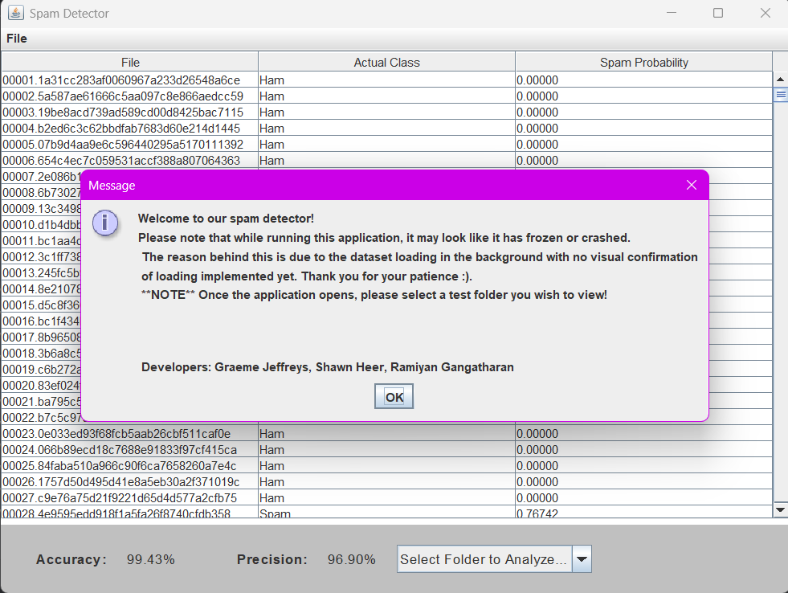
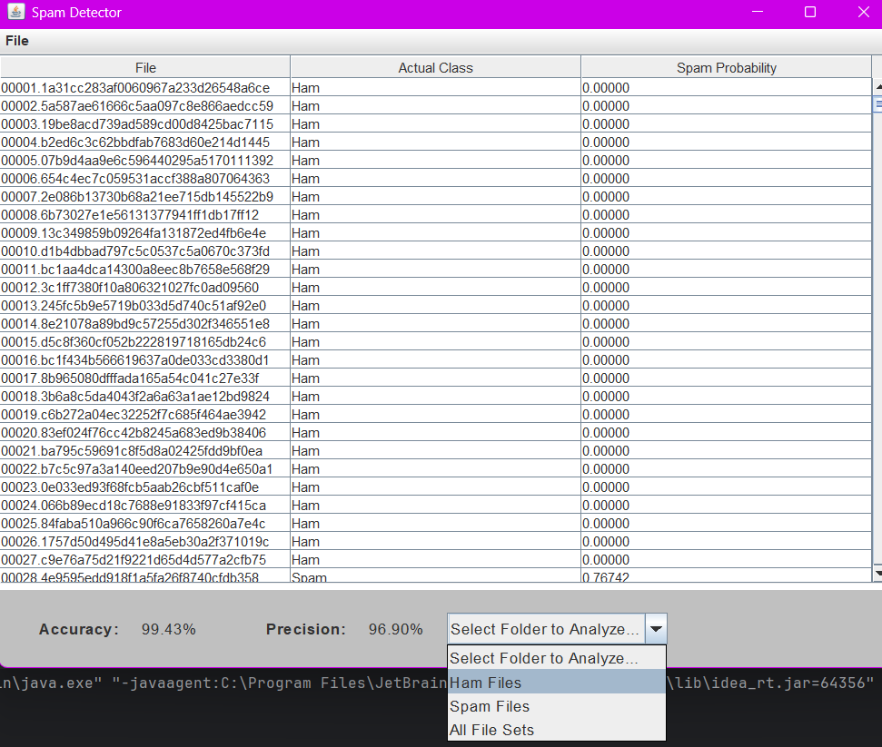
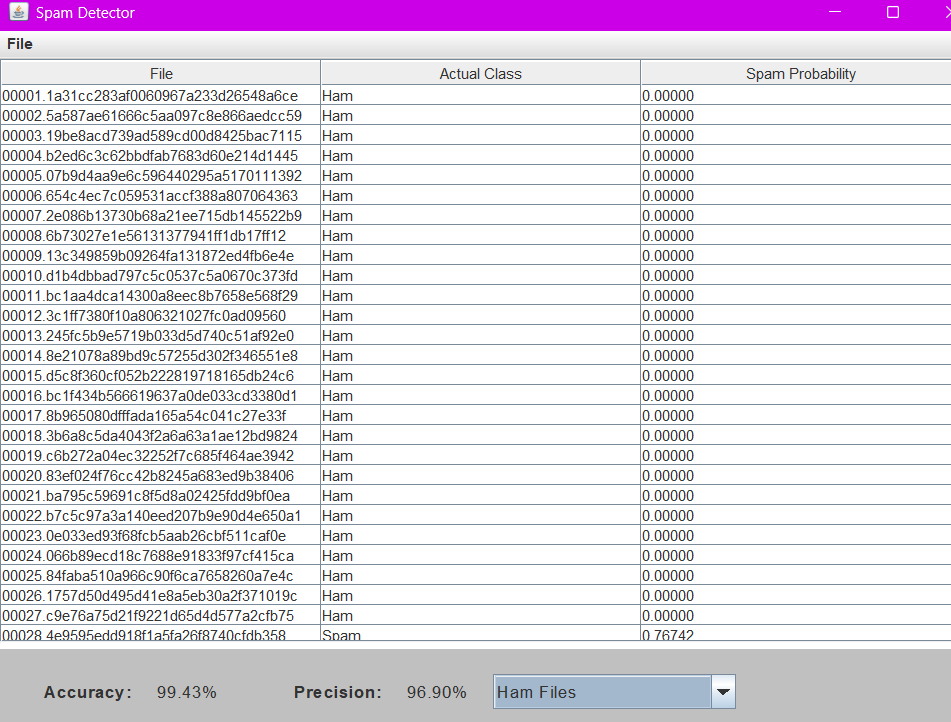
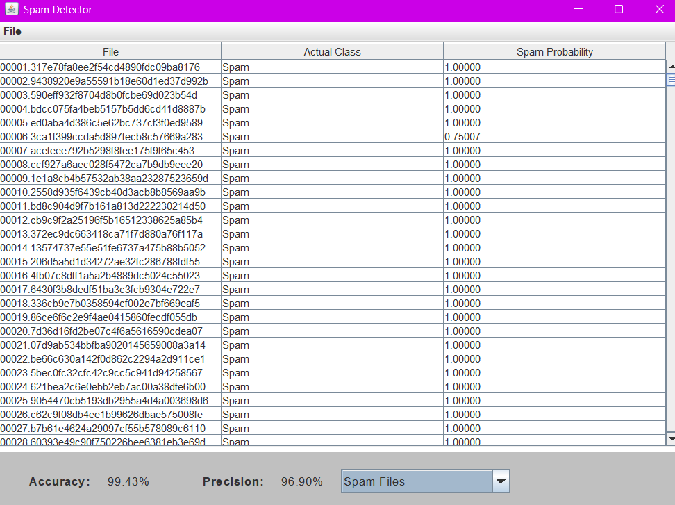
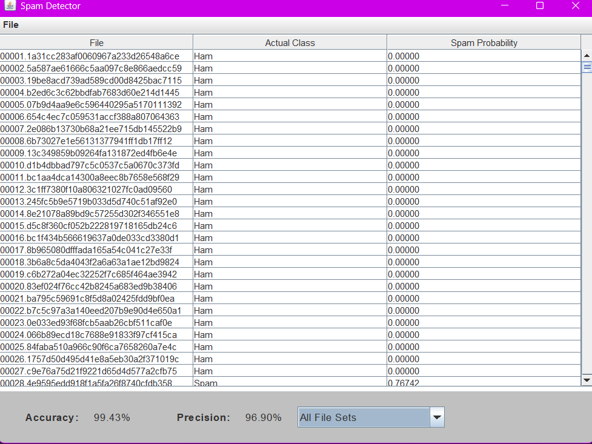
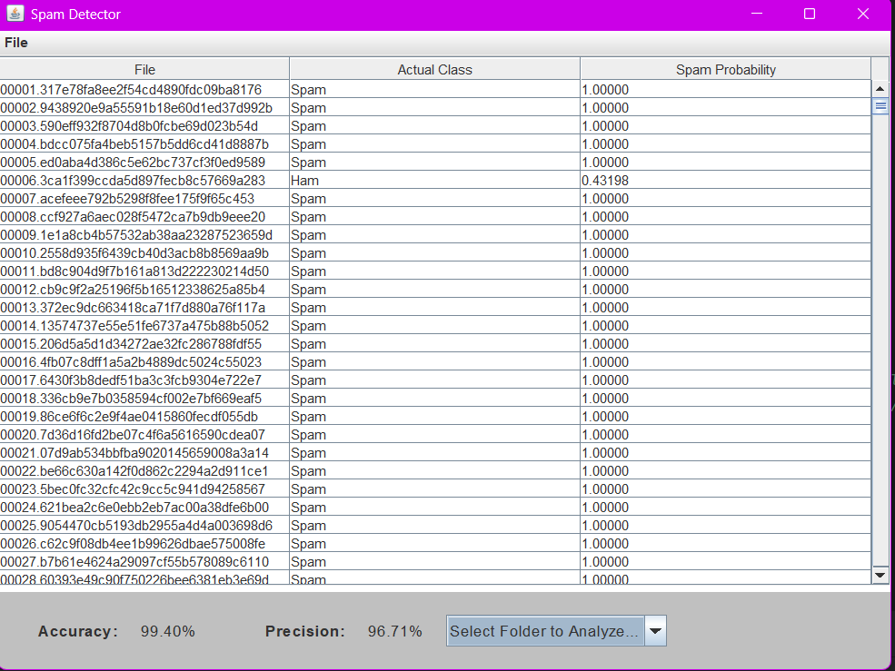
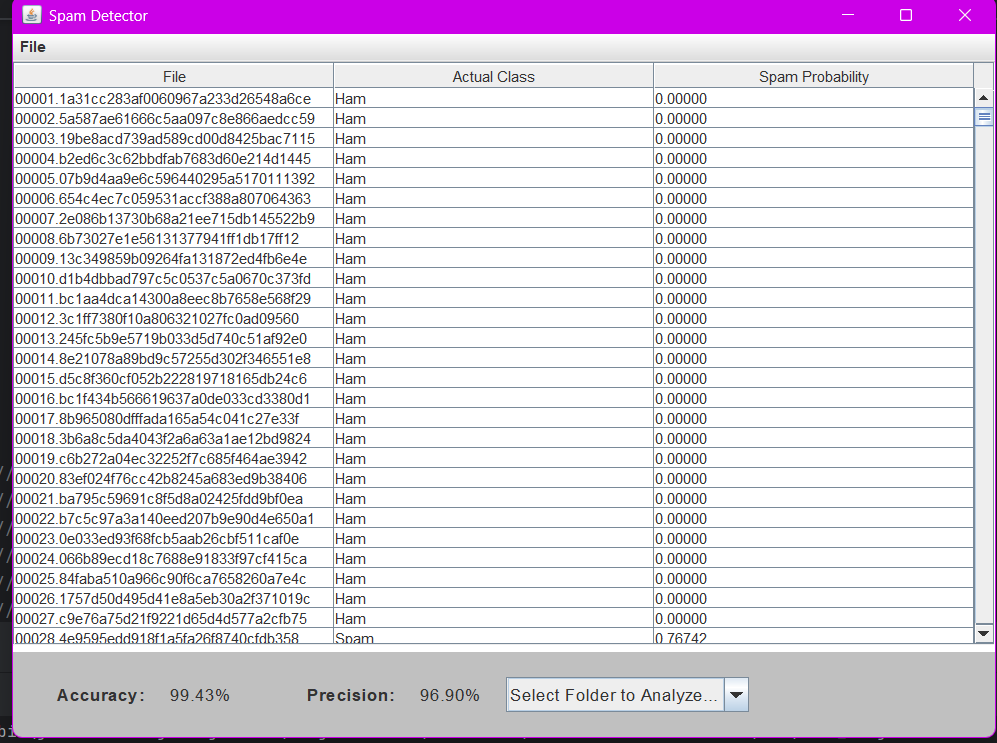

# A1 Spam Detection
Developed by: Graeme Jeffreys, *removed*, and *removed*
Please contact Graeme to contact partners. Names removed for privacy reasons.

Date: 2026-03-01

## Description
We have created a spam detector that is trained at runtime on a dataset
of emails that are distinguished as either spam, or not. Once trained, this
program will then go through test files to determine the probability of whether 
the new test files are spam, or "ham", based on the statistics
of the training sets. To do this, this program uses a Bayes statistical 
function to calculate the probability of the file being spam or not, and uses various 
implementations of word filtering to reduce white noise, neutral words, and 
more - bringing our precision up drastically, and impoving accuracy to almost 100%.

This program uses a GUI to display the files, and prompts the user with a welcome message, and
then presents the viewable data in a few formats. On run, the program will first generate a white noise list,
and use it alongside other filtering to clean the training data, and train the statistical model with training datasets. 
After training it will perform the calculations and present information, files, and calculated probability
in the GUI.

## Java Project Summary

This is a Java desktop application built with Maven and Swing. It preprocesses training and test email files, then uses a Bayes-based probability model to estimate whether messages are spam or ham. The GUI displays results for the available test folders. Results depend on the supplied data and should not be treated as a guarantee of accuracy.

## Screenshots:

App on open - welcome message, basic instructions, and default load with both folders:

Drop down menu:

Ham folder:

Spam folder:

All folders:

## Added Improvements
**Clean files**: we initially used an AI generated list of "white noise" words, and remove these words
to clean the files of these white noise words. HOWEVER, using the given statistical formula, we created a white noise
generator that generates and returns a "white noise list" based on the training data that we used to produce a better result.

**Low frequency words**: If a word only shows up in three files, the probability function removes
this word from contributing to the overall probability statistic, which improves precision.

**Neutral Word Filtering**: If a word has a probability of being both HAM and SPAM, ~~0.5,
we remove the word to increase precision. 

**GUI Cleanup**: Improved the aesthetics of the user interface to make it look more modern.

**Dropdown Menu**: To view the various test folders, or all folders.

**Menu Bar**: For accessibility purposes, we have created multiple ways to navigate the application 

**White noise word filtering**: Implemented a function using the probability model provided to determine high frequency
words, and words within certain parameters. First we used the AI generated word list but it produced a lower accuracy
and precision. Our improvement increases accuracy by 0.03% and precision 0.19% which is still an improvement.

_Screenhot of our initial test with white noise list from gen AI:_

_Screenshot of our test after implementing new function and removing the gen AI list:_

### **_Note: After trying with both our new implementation of the white noise filtering, and the AI gen list together, we determined that the combination made no impact on results, since our white noise generation function is more comprehensive and produced the best results in testing._**

## How to Run
In order to run this application: 
1. Navigate to our main.java file and **run** its executable.
2. Give the application a minute to clean the data, generate a white noise list, calculate training statistics, and then
perform statistical probability on the test data.
3. When prompted with the welcome message, press "okay" to continue
4. View the basic default screen with holistic statistics presented in percentage, and then use the menu drop down.
5. The menu drop down will provide viewing of 3 folder choices: ham, spam and all(default)
6. To close, press the close button located at the top right of the application popup to close application, and exit run status.

#### **CAN USE THE runClean.java FILE TO CLEAN THE CLEANED DATA FOLDERS!**

## Other Resources

### Java Swing Invoke help
Used this to help understand runtime errors and other issues solved with javaswing invoke.

Link: https://www.delftstack.com/howto/java/java-swingutilities.invokelater/
Link: https://www.javaspring.net/blog/java-awt-eventqueue-invokelater-explained/

